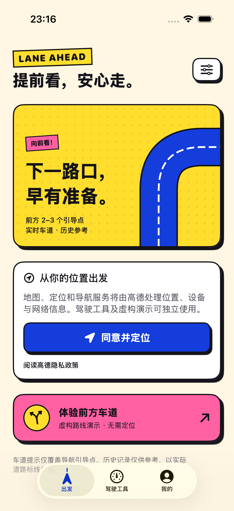
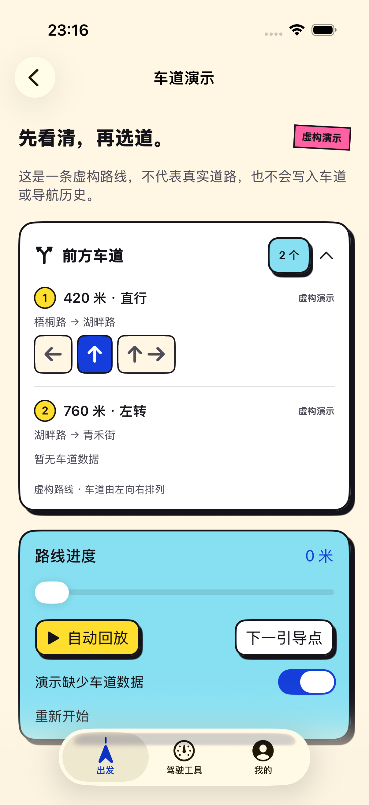
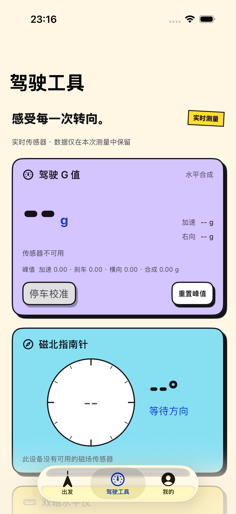

# LaneAhead · iOS

LaneAhead 鸿蒙版的原生 iPhone 实现。SwiftUI 页面、高德 iOS 导航 SDK、Core Motion 驾驶工具与本机历史存储，最低支持 iOS 17。

鸿蒙版仓库：[LaneAhead · HarmonyOS](https://github.com/dantinr/lane-ahead-harmony)。

车道演示、驾驶工具与本地历史页面可独立运行；真实地图、地点搜索、选路及 GPS 导航需要配置本机 iOS Key 后在真机使用。接入代码已编译通过，实际服务与道路效果需分别联调验证。演示不写入真实历史。

## 界面预览

默认采用波普主题：奶油白底、电光蓝、亮黄与洋红色块，搭配漫画网点、粗黑描边和硬阴影。实时车道使用蓝色推荐，历史车道使用黄色参考，并保留来源文字。

| 首页 | 车道演示 | 驾驶工具 |
| :---: | :---: | :---: |
|  |  |  |

以上为 iOS 模拟器截图：首页展示首次使用引导，车道预览使用虚构演示数据，驾驶工具展示模拟器的传感器不可用状态。截图不包含真实定位、路线或历史记录。

## 功能

- 前方 2／3 个导航引导点的距离、方向、实时车道和历史参考；缺失数据保持未知。
- 关联当前路线的单信号灯引导点后立即保存车道，重复回调去重，结构或推荐转向冲突时撤销。
- 车道长期保存，满三个日历月提示待更新；记录浏览、筛选、清除和采集诊断。
- 当前城市搜索、明确城市关键词、去过城市补查、搜索历史和常去地点 Top 5。
- 当前定位选路、确认后开始 GPS 导航、语音与指定起点规划预览。
- 最近 200 次导航历史；真实 GPS 导航开始后才记录，异常退出恢复为中断。
- 驾驶 G 值、停车校准、峰值、磁北指南针、双轴水平仪。
- 大众 Logo 车辆标记随可靠 GPS 车速旋转，停车、弱定位与后台时暂停动画。

SDK 引导点不是所有物理路口，首次经过或缺少匹配历史时，未来点可能没有车道。历史参考不能替代实际道路标线。

## 运行

需要 macOS、Xcode 和命令行工具。首次准备：

```bash
python3 scripts/setup-sdk.py
python3 scripts/prepare-config.py
python3 scripts/generate-project.py
open LaneAhead.xcodeproj
```

不需要安装 CocoaPods 或 XcodeGen。SDK 从高德官方地址下载到被忽略的 `Vendor/`，校验固定 SHA-256；来源和版本见 `scripts/sdk-manifest.json`。采用无 IDFA 的基础 SDK，并包含官方隐私清单。

```bash
bash scripts/build.sh simulator  # 可运行的模拟器版本
bash scripts/build.sh test       # Swift 纯逻辑测试
```

官方 SDK 当前归档包含真机 arm64 与模拟器 x86_64，缺少 Apple Silicon 模拟器 arm64。因此模拟器使用明确隔离的地图适配层：可以测试 SwiftUI、演示、历史与不可用状态；真实高德地图、搜索和导航须在 iPhone 真机运行。模拟器没有真实传感器时显示未知，不注入假读数。

## 配置地图与真机安装

默认包名：`com.laneahead.ios`。

1. 在高德开放平台创建绑定该包名的 **iOS Key**，开通所需地图、搜索及导航服务。
2. 把 Key 的 32 位文本保存到 `.local/k`，也兼容 `.local/gaode-ios`；两者存在时优先使用 `.local/k`。不要使用鸿蒙 Key 或 Web 服务 Key。
3. 在 Xcode 的 Signing & Capabilities 中选择自己的 Team，或者将 Team ID 保存到 `.local/team-id`。
4. 手机开启开发者模式、连接并信任 Mac。首次安装按系统提示信任开发者。

```bash
DEVELOPMENT_TEAM=你的TeamID bash scripts/build.sh device
xcrun devicectl list devices
bash scripts/install.sh 设备标识
```

脚本安装支持设备 UUID、UDID 或设备名，内部读取真机 UDID 供 Xcode 使用。签名需要 Mac 上的开发证书私钥可访问；如果出现钥匙串窗口，需要在系统窗口授权。不要把密码写入脚本。

配置资源由构建前脚本生成，实际 Key、Team 本机文件、SDK 二进制、构建产物和设备截图均被 Git 忽略。更换 Key 后重新构建安装。免费个人开发签名的实际有效期以生成的 provisioning profile 为准。

## 验证

2026-11-06：53 项 Swift 核心测试、2 项模拟器界面测试通过；模拟器构建和真机 SDK 链接、开发签名构建通过。已检查首页、车道演示和驾驶工具的模拟器截图。开发包已安装到已授权的 iPhone 14 Pro Max 并成功启动。

```bash
swift test
xcodebuild -project LaneAhead.xcodeproj -scheme LaneAhead \
  -destination 'platform=iOS Simulator,id=你的模拟器UDID' \
  -derivedDataPath build/simulator -parallel-testing-enabled NO \
  CODE_SIGNING_ALLOWED=NO -only-testing:LaneAheadUITests test
```

尚未验证：Key 鉴权、真实地点请求、实际道路导航、未来车道覆盖与匹配、重复行驶历史复用、锁屏和后台持续导航、传感器绝对精度。测试样本不代表实车结果。详细对照见 [功能与验证](docs/parity-and-validation.md)。

## 代码入口

| 目录 | 职责 |
| --- | --- |
| `LaneAhead/App` | App 入口与前后台生命周期 |
| `LaneAhead/Core` | 可独立测试的车道、搜索、历史与传感器算法 |
| `LaneAhead/Bridge` | 高德 Objective-C 接入与模拟器隔离 |
| `LaneAhead/Services` | 导航会话、定位权限、异步查询、文件和传感器调度 |
| `LaneAhead/Views` | 首页、搜索、选路、面板、工具、历史、设置与演示 |
| `Tests/Core`、`Tests/UI` | 算法和存储回归测试、界面流程验证 |

纯逻辑可通过 Swift Package 独立测试；App 将同一份 Swift 源码编入 Xcode target。修改文件后可重新运行工程生成脚本，版本从 `VERSION` 读取。
